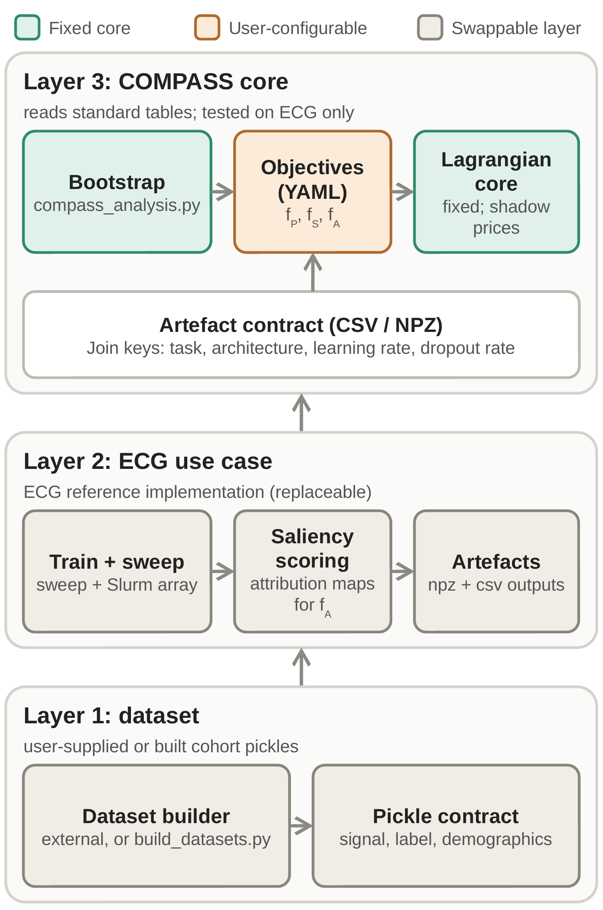

# COMPASS

**Constrained Objective Multi-criteria with Performance, Auditability, Stability and Saliency.**

COMPASS helps you choose among trained models on more than predictive accuracy.
It scores every candidate configuration on performance ($f_P$), stability ($f_S$)
and auditability ($f_A$), then selects the best-performing configuration that
meets user-defined minimum levels of stability and auditability ($K_S$, $K_A$).
It also estimates how much performance each stricter threshold costs, and maps the
threshold combinations for which no candidate is feasible. You can replace the three
scores; the constrained selection step is fixed.

| Objective | Symbol | Default meaning (ECG reference analysis) |
|-----------|--------|-------------------------------------------|
| Performance | $f_P$ | Mean of bootstrap accuracy, precision, recall and specificity, min-max normalised within each task |
| Stability | $f_S$ | One minus the min-max normalised mean bootstrap standard deviation of the same four metrics (higher = more precise estimate) |
| Auditability | $f_A$ | Equal mean of saliency continuity, compactness and contrastivity, each between 0 and 1; not rescaled |

**What the scores mean, and what they do not.** The defaults are proxies for
trustworthiness, not clinical validation, and $K_S$ and $K_A$ are user-defined
thresholds, not clinically derived limits.

- $f_P$ and $f_S$ are normalised within each task, so $K_S$ is relative to the candidates
  of that task. $f_A$ is not rescaled, so $K_A$ is an absolute level on a scale from 0 to 1.
- $f_S$ is *evaluation stability*: how much the performance estimate varies when the test
  set is resampled. It is not model robustness, stability across retraining or seeds,
  or stability under distribution shift.
- $f_A$ describes inspectable properties of attribution maps. It does not establish
  faithfulness to the model or agreement with clinical knowledge.
- Shadow prices are finite-difference estimates over a discrete set of candidate
  configurations, not classical Lagrange multipliers. At a "cliff", where a stricter
  threshold leaves no feasible candidate, the estimate is undefined (written as `null`).

## Scope

- The selection core (`src/compass/`, `src/compass_analysis.py`) works on standard
  tables of measured quantities and does not read waveforms. Its use outside ECG has
  **not** been evaluated.
- The bundled ECG pipeline (training, saliency scoring) was developed and tested on
  12-lead input with balanced two-class tasks. The signal length is set in the
  configuration (`ecg.signal_len`): 5,000 samples (10 s at 500 Hz) for MIMIC-IV-ECG,
  and 384 samples for the resampled single beats of the Psychiatry ECG dataset.
  Other lead counts or sampling rates need your own preprocessing and have not been tested.

---

## Install

```bash
git clone https://github.com/Ja5ya/compass.git
cd compass
python -m venv .venv && source .venv/bin/activate
pip install -r requirements.txt
```

Requirements: Python 3.10+ and TensorFlow 2.15 to 2.20 for the ECG training and
saliency path (`requirements.txt`). The analysis in the accompanying paper used
Python 3.10.12, TensorFlow 2.20.0 and Keras 3.12.1; other versions are untested.

### Data-free demo (start here)

Runs the **real selection core** (bootstrap, join, scoring, constraints, shadow
prices, frontier) on **fabricated** prediction and attribution tables. It needs no
GPU, TensorFlow, PhysioNet access or Kaggle download, only the four packages in
`examples/synthetic/requirements.txt`, and takes about 10 seconds.

```bash
pip install -r examples/synthetic/requirements.txt
bash examples/synthetic/run.sh
# or: make demo
```

The six runs are generated by `make_synthetic.py`, not by training or `run_xai.py`,
so all printed metrics are synthetic. The demo covers the join and constrained
selection core, including a binding constraint and a cliff. It does **not** cover model
training or attribution scoring. Details: [examples/synthetic/README.md](examples/synthetic/README.md).

### Your own candidate table (no pipeline)

Already have a table with one row per candidate model? Apply the selection core to it
directly: scoring, constrained selection, shadow prices and feasibility frontier, with
the same four packages as the demo.

```bash
python examples/candidate_table/run_candidate_table.py
```

The input is `examples/candidate_table/candidates.csv` (eight fabricated candidates) and the
expected output is in `examples/candidate_table/expected_output.txt`. Details:
[examples/candidate_table/README.md](examples/candidate_table/README.md).

Full ECG runs with MIMIC-IV-ECG (credentialed labels) or the open
[Psychiatry ECG](https://www.kaggle.com/datasets/buraktaci/psychiatry-ecg) dataset are
optional. They need TensorFlow and, for a useful sweep, a GPU or a Slurm cluster.
No patient data are distributed with this repository.

---

## Documentation

| Document | When to read it |
|----------|-----------------|
| [examples/synthetic/](examples/synthetic/) | Data-free demo of the selection core |
| [examples/candidate_table/](examples/candidate_table/) | Selection core on your own candidate table, with expected output |
| [docs/QUICKSTART_CUSTOM_STUDY.md](docs/QUICKSTART_CUSTOM_STUDY.md) | New dataset, custom $f_P$, $f_S$, $f_A$, full walkthrough |
| [docs/DATA_CONTRACT.md](docs/DATA_CONTRACT.md) | Pickle and CSV schemas, configuration reference, objective extension levels |
| [docs/REPOSITORY_SCOPE.md](docs/REPOSITORY_SCOPE.md) | What is in this repository and what users supply |
| [docs/ARCHITECTURE.md](docs/ARCHITECTURE.md) | Pointer to the documents above |
| [examples/dataset_builders/](examples/dataset_builders/) | Optional MIMIC and Psychiatry ECG dataset builders |



Teal: fixed selection core. Amber: user-configurable $f_P$, $f_S$, $f_A$. Gray:
swappable dataset and ECG use-case layers.

---

## Three layers

| Layer | What | In this repo |
|-------|------|--------------|
| 1. Dataset | User-built pickles or optional builders | `configs/*.yaml` (`data.mode`) |
| 2. ECG use case | Training sweep and saliency scoring (swappable) | `train_multi_f_array.py`, `run_xai.py` |
| 3. COMPASS core | Bootstrap, objectives, constrained selection, frontier | `compass_analysis.py`, `src/compass/` |

**New study?** See [docs/QUICKSTART_CUSTOM_STUDY.md](docs/QUICKSTART_CUSTOM_STUDY.md).

---

## Pipeline (five stages)

| Stage | Script | Main output |
|-------|--------|-------------|
| 1. Dataset | `build_datasets.py` (optional) | Pickles under `datasets/` |
| 2. Train sweep | `train_multi_f_array.py` | `hyper_sweep/.../test_predictions.npz` |
| 3. Saliency | `run_xai.py` | `xai_results/.../sweep_fa_<task>.csv` |
| 3b. Merge | `compass_analysis.py merge-fa` | `sweep_fa_summary.csv` |
| 4. Bootstrap | `compass_analysis.py bootstrap` | `bootstrap_results.csv` |
| 5. Frontier | `notebooks/02_feasibility_frontier.ipynb` | `analysis/three_objective_dataset.csv` |

All outputs are written under `COMPASS_DATA_ROOT` or `output_root` in your YAML config.

---

## Reference run: MIMIC on Slurm

```bash
cp configs/env.mimic.example configs/env.mimic   # edit COMPASS_CONFIG, COMPASS_DATA_ROOT, COMPASS_PREBUILT_ROOT
source configs/env.mimic

bash slurm/submit_train.sh    # stages 2 and 4 (training and bootstrap)
# wait for completion
bash slurm/submit_xai.sh      # stages 3 and 3b (saliency and merge-fa)

PYTHONPATH=src python src/compass_analysis.py --config $COMPASS_CONFIG status
jupyter notebook notebooks/02_feasibility_frontier.ipynb
```

**Run order:** train, bootstrap, saliency, merge-fa, frontier. Do not submit saliency
scoring until training has finished.

**Local smoke test** (one task, no Slurm):

```bash
source configs/env.mimic
PYTHONPATH=src python src/train_multi_f_array.py --config $COMPASS_CONFIG --task-id 0
N_BOOTSTRAP=100 PYTHONPATH=src python src/compass_analysis.py --config $COMPASS_CONFIG bootstrap
PYTHONPATH=src python src/run_xai.py --config $COMPASS_CONFIG --code F329 --hyper_sweep_fa
PYTHONPATH=src python src/compass_analysis.py --config $COMPASS_CONFIG merge-fa
```

Example configurations: `configs/mimic.yaml` (six-task test grid),
`configs/mimic_f329.yaml` (full single-code sweep), `configs/ecgpsych.yaml`
(Psychiatry ECG dataset), `configs/dataset.template.yaml` (build-mode starting point).

Sweep size is `n_codes x n_architectures x n_learning_rates x n_dropout_rates`. Check it with:

```bash
PYTHONPATH=src python src/pipeline_config.py --config $COMPASS_CONFIG sweep-count
```

---

## Environment variables

Environment variables use the `COMPASS_` prefix.

| Variable | Meaning |
|----------|---------|
| `COMPASS_CONFIG` | Path to the study YAML |
| `COMPASS_DATA_ROOT` | Writable run directory |
| `COMPASS_PREBUILT_ROOT` | Root of prebuilt pickles (`data.mode: prebuilt`) |
| `COMPASS_AUTO_BOOTSTRAP` | `1` (default): chain bootstrap after `submit_train.sh` |
| `COMPASS_AUTO_MERGE_FA` | `1` (default): chain merge-fa after `submit_xai.sh` |
| `N_BOOTSTRAP` | Bootstrap resamples (default `1000`; use `100` for tests) |
| `XAI_MODE` | `sweep` (default) or `pareto` |

Full list: [docs/DATA_CONTRACT.md](docs/DATA_CONTRACT.md#configuration-reference).

---

## Custom objectives

Edit `objectives:` and `analysis:` in your study YAML, or post-process
`analysis/objective_inputs.csv`. The three extension levels (YAML, pandas, your own
CSVs) are described in
[docs/DATA_CONTRACT.md](docs/DATA_CONTRACT.md#objective-extension-levels), and a
walkthrough is in [docs/QUICKSTART_CUSTOM_STUDY.md](docs/QUICKSTART_CUSTOM_STUDY.md).
For a minimal worked case that starts from a plain table, see
[examples/candidate_table/](examples/candidate_table/).

---

## Testing

```bash
pip install pytest
PYTHONPATH=src python -m pytest tests/ -v
```

Tests that need data are skipped unless `COMPASS_PREBUILT_ROOT` is set.

---

## Citing COMPASS

Please cite the software release you used. Citation metadata, including the authors
and version, are in [CITATION.cff](CITATION.cff); GitHub's "Cite this repository"
button reads it. The accompanying SoftwareX article will be added to `CITATION.cff`
once it is published. Authors are listed in [authors.rst](authors.rst).

## License

MIT, see [LICENSE](LICENSE).